<p align="center">
  
</p>


<h1 align="center">tideSI</h1>

<p align="center"><em>Watch the tide of your Super Intelligence usage.</em></p>

<p align="center">
  <a href="https://www.opendesktop.org/p/2361382/">
    
  </a>
  
  <a href="LICENSE">
    
  </a>
  <br/>
  <a href="https://www.opendesktop.org/p/2361382/">
    
  </a>
  
  
</p>

tideSI is a KDE Plasma 6 panel widget, a Hyprland/Quickshell shell, a tray app for Windows, macOS and other desktops, and a terminal CLI for tracking AI API quota usage across 25 provider services. Monitor subscription windows, account balances, local activity, and per-model usage through the shared backend, with animated segmented bars, live countdown timers, and account status.


## Screenshots

### Panel

| Claude | Antigravity |
| :---: | :---: |
|  |  |

### Popup

| Claude | Claude stats |
| :---: | :---: |
| 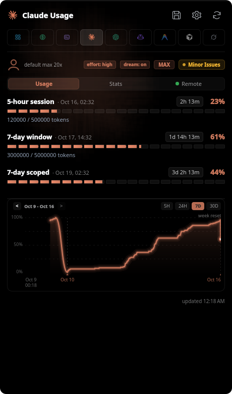 | 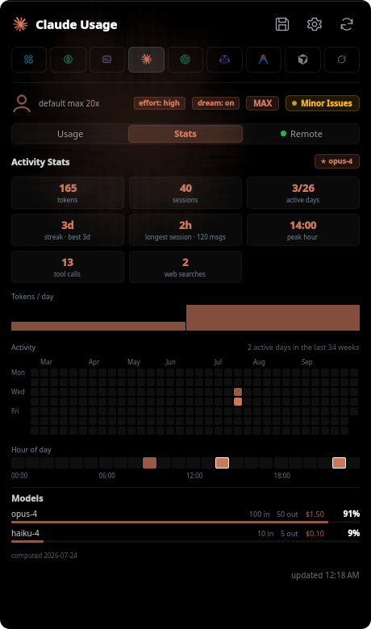 |
| **Antigravity** | **OpenAI** |
| 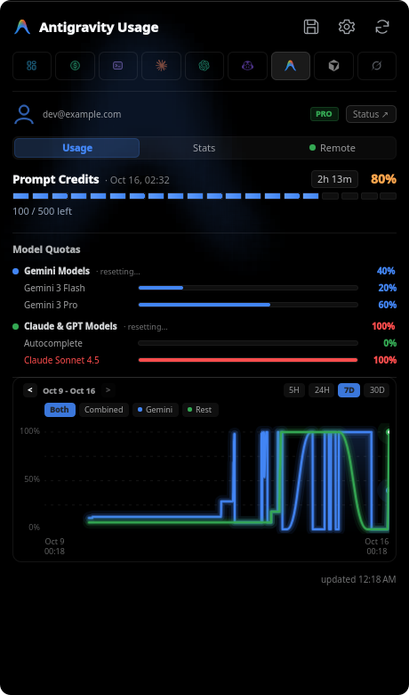 | 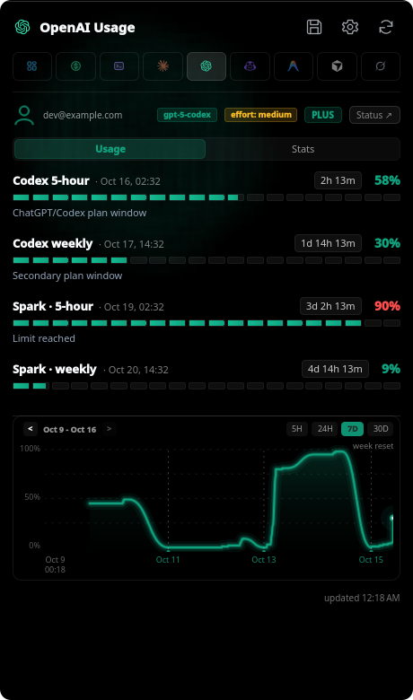 |
| **Antigravity remote** | **Claude remote** |
| 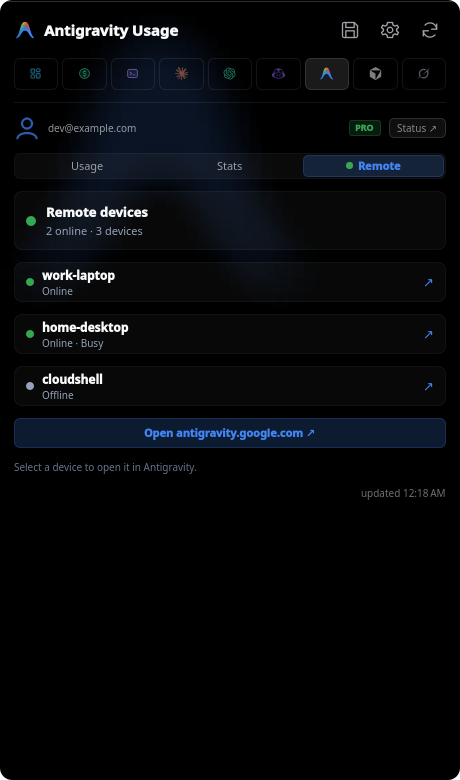 | 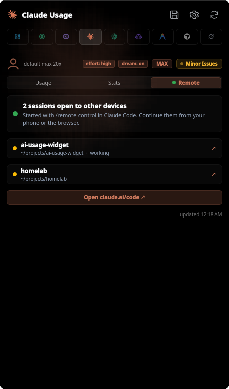 |
| **Overview** | **Sessions** |
| 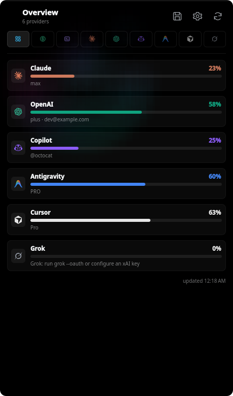 | 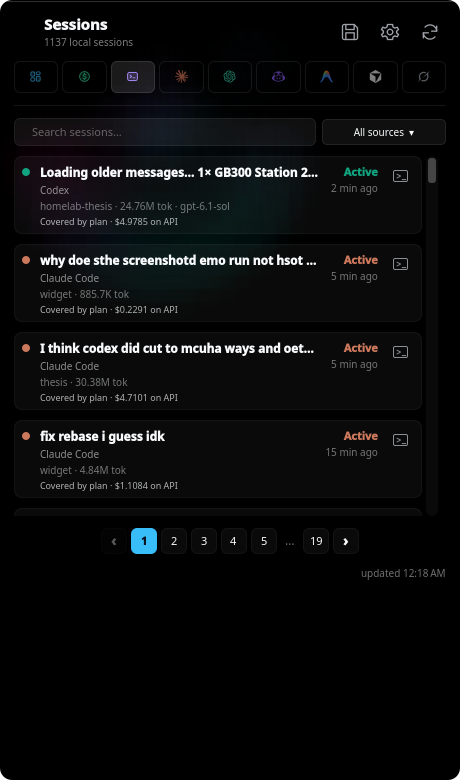 |
| **Usage & Spend** | **Settings** |
| 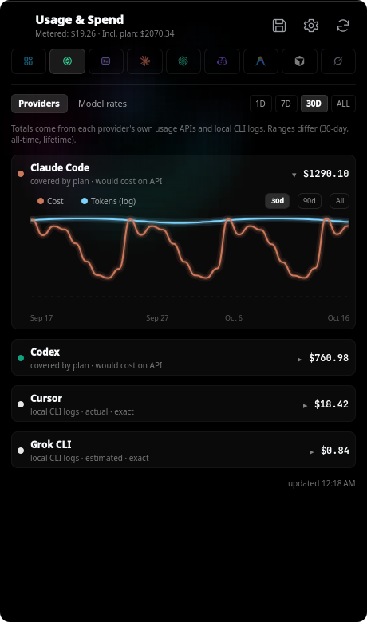 | 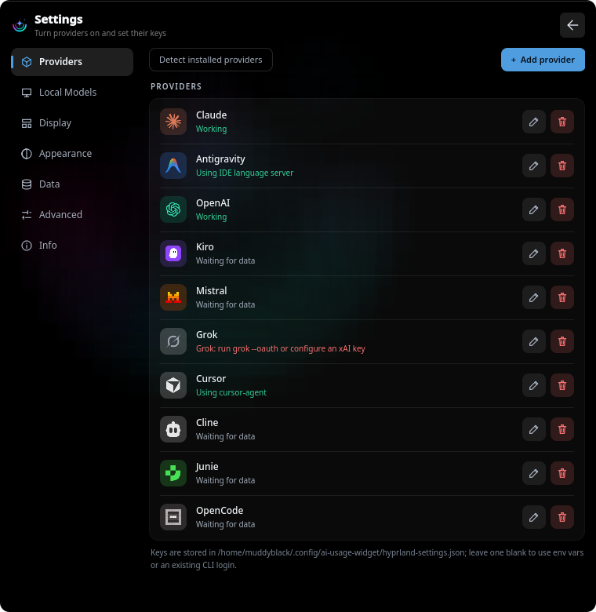 |

Generated from the real UI with demo data: `make readme-screenshots`.

### macOS and Windows

Real desktop captures from PR #70 (`b92b5ce`), using demo data. Click an image
for the full-size view, including the native menu bar or taskbar.

| View | macOS | Windows |
| :--- | :---: | :---: |
| Sessions | <a href="./docs/readme/macos/desktop-00-sessions.png">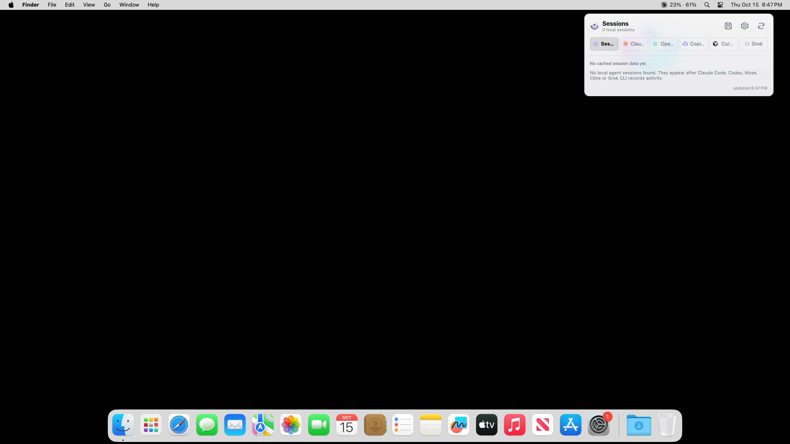</a> | <a href="./docs/readme/windows/desktop-00-sessions.png">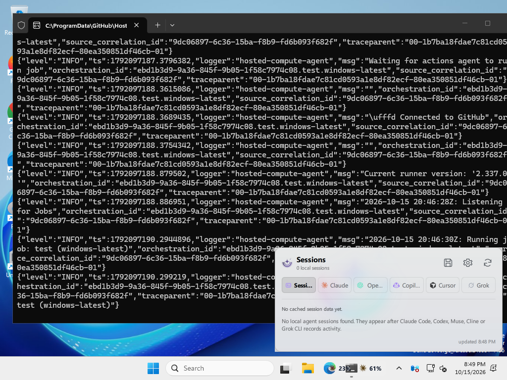</a> |
| Claude usage | <a href="./docs/readme/macos/desktop-01-claude.png">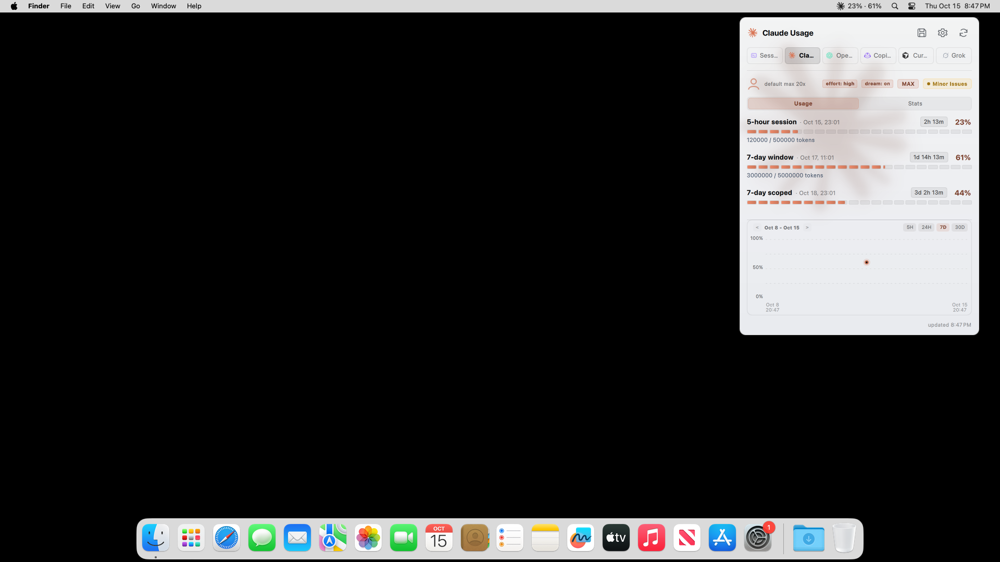</a> | <a href="./docs/readme/windows/desktop-01-claude.png">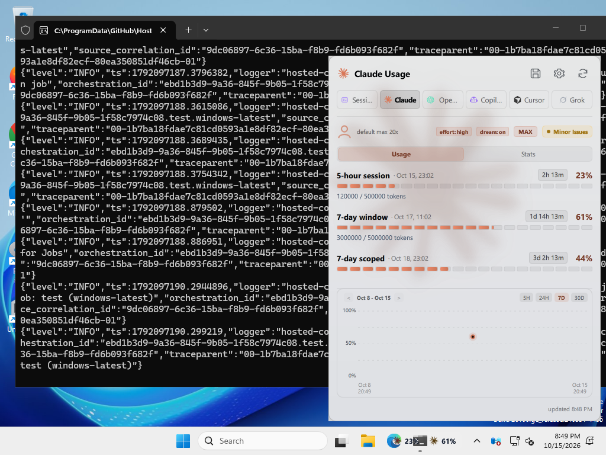</a> |
| OpenAI usage | <a href="./docs/readme/macos/desktop-02-openai.png">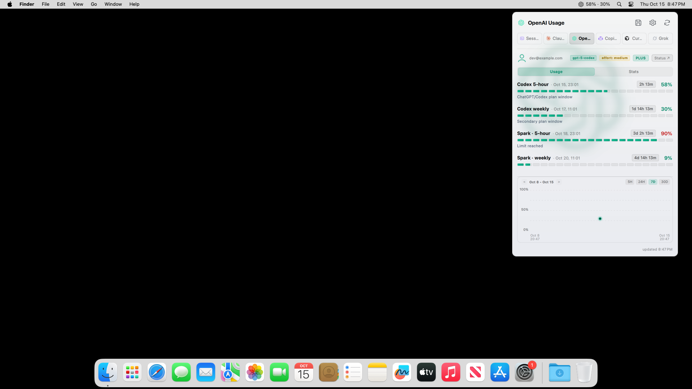</a> | <a href="./docs/readme/windows/desktop-02-openai.png">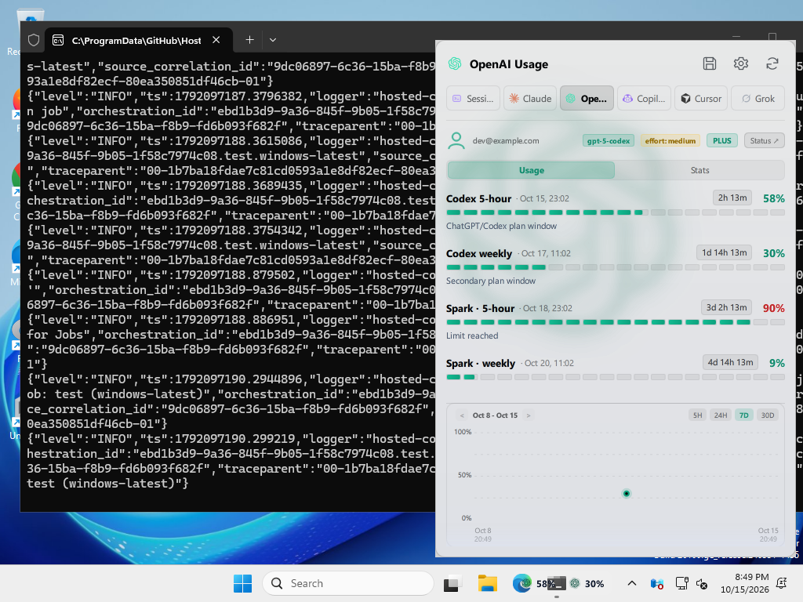</a> |
| Provider settings | <a href="./docs/readme/macos/desktop-03-settings-providers.png">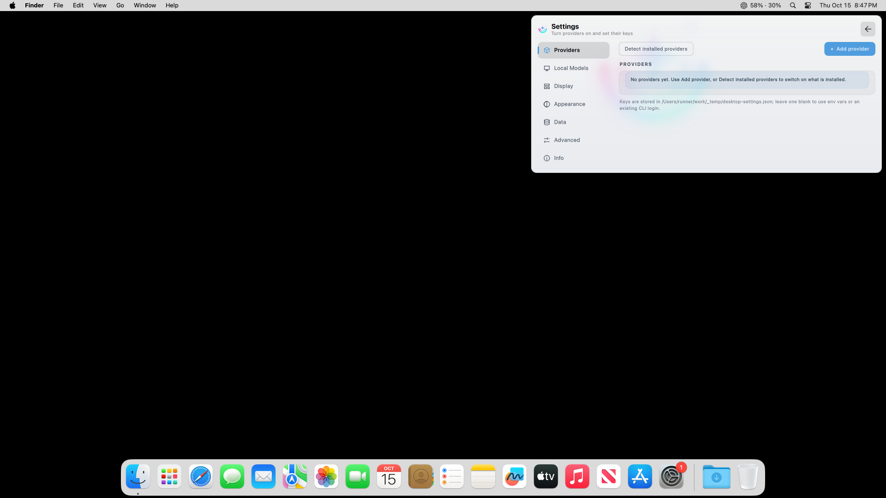</a> | <a href="./docs/readme/windows/desktop-03-settings-providers.png">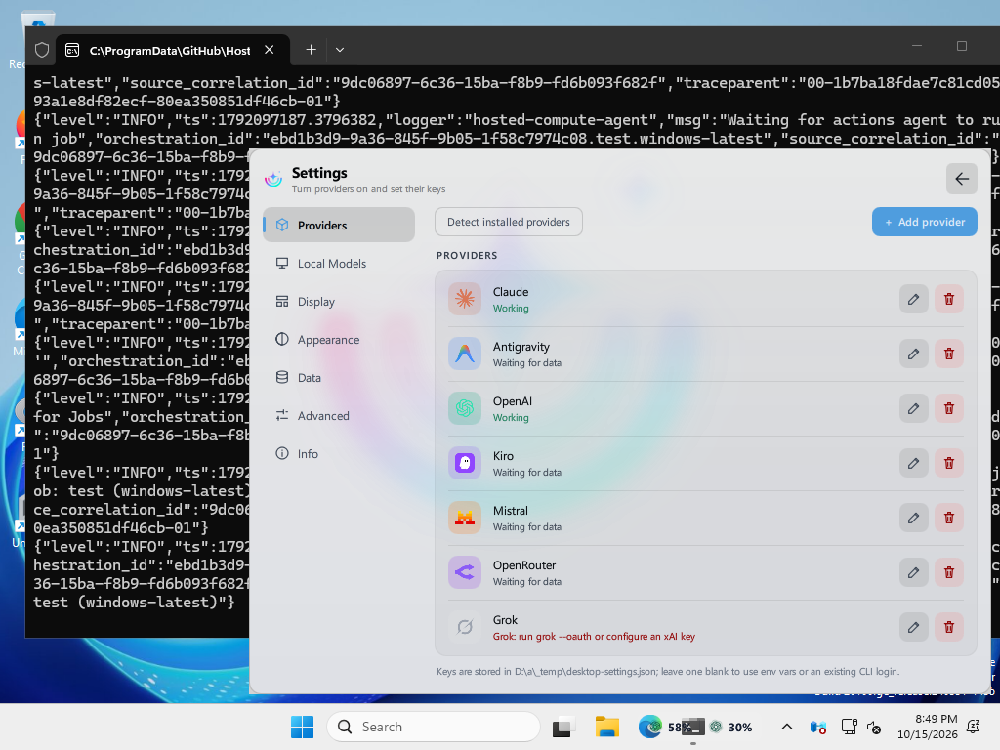</a> |
| Appearance settings | <a href="./docs/readme/macos/desktop-04-settings-appearance.png">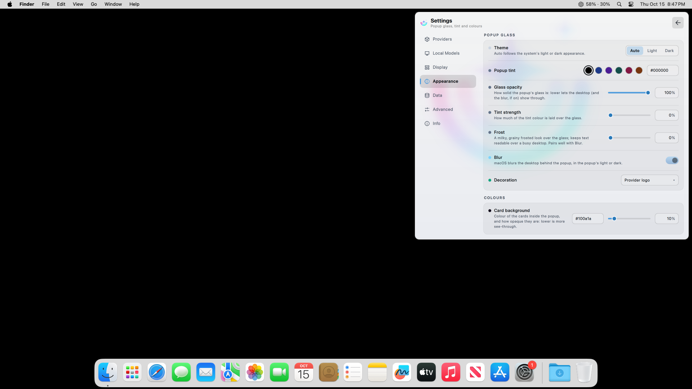</a> | <a href="./docs/readme/windows/desktop-04-settings-appearance.png">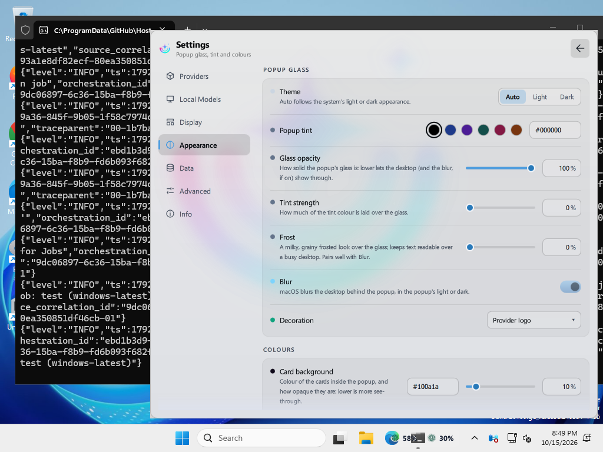</a> |

---

## Features

- **Add providers from a search, pick how each is read** — Settings → Providers shows what is on and how it is being read; a provider's page lists its sources (CLI, IDE, local server, API key) with a working indicator, and an optional HTTP proxy is under Advanced
- **Multi-service support** — 25 providers in one popup, each on its own tab
- **Panel view** — Compact percentage readouts in the taskbar, color-coded by usage level, with an inline spark-line trend
- **Popup view** — Segmented bars showing exact fill level with reset times and live countdowns that show "resetting..." when a window flips
- **Usage chart** — Smooth, glowing area chart of historical usage with availability-aware 5H / 24H / 7D choices and hover-scrub
- **Burn-rate ETA** — Estimates time to 100% from your recent trend (e.g. "↗ ~3h to 100%") for each available window
- **Period comparison** — Shows how today/this week compares to the same point last period (e.g. "+12% vs last week")
- **Cost aggregation** — Combined API spend across Claude, OpenAI, and OpenRouter in the footer
- **Model breakdown** — Usage per model for providers that expose it
- **Theme-aware accent** — Follows your Plasma accent color by default, or use per-service brand colors
- **Glassmorphism popup** — Translucent, blurred popup styling, with percentages that roll up and down smoothly
- **Color thresholds** — Amber at 70%, red at 90%
- **Pin services** — Pin one or more tabs so they stay visible on the panel; with no pins, the panel mirrors the active tab
- **Optional Plasma panel rotation** — Choose Off, 30 seconds, 1 minute, 2 minutes, 5 minutes, or 10 minutes in Appearance to show pinned providers one at a time in pin order; disabled by default
- **History export / import** — Save and restore usage history as JSON; history is mirrored to disk so it survives reinstalls
- **Robust refresh** — Poll interval from 1 to 30 minutes, respects `retry-after` headers, dims and shows the error inline when a fetch fails
- **Optional Overview / Usage & Spend / Sessions tabs**, turn on in Settings → Views. Overview shows every enabled provider at a glance, Usage & Spend shows provider-reported spend and non-navigable local source rows, and Sessions lists recent local Claude Code / Codex / Grok CLI / Cline / OpenCode / MiMo Code / Junie / Antigravity / Muse activity, local title previews and recency; previews may contain sensitive text, with a ⧉ button to resume a session in your terminal (`get-ai-usage --sessions` / `--open-session <key>`; not available for Muse, which ships no resume command)

## Session costs and Usage & Spend

Sessions may include structured `costUSD` and `costStatus` fields. The status is
`exact`, `partial`, or `unavailable`. Token-derived costs are exact only when
the model matches the cached pricing catalog. Finite USD costs reported by a
provider can be exact. A mix of known and unknown models is partial. Unknown,
missing, or invalid model usage is unpriced and never estimated.

The optional `costProvenance` field says where a numeric session cost came from:
`actual` is a finite provider-reported USD amount, `estimated` is calculated
from exact local token usage and an exact cached model rate, and `mixed` contains
both kinds. A mixed row also carries finite non-negative
`costBreakdown.actualUSD` and `costBreakdown.estimatedUSD` values whose sum
matches `costUSD`; it is not a bill. Provenance is independent of coverage:
`partial` means some usage could not be priced, while `unavailable` means there
is no trustworthy numeric result.

Token estimates use exact OpenCode provider/model IDs and USD-per-million-token
rates from models.dev first, with LiteLLM fallback for Anthropic and OpenAI.
The shared catalog is cached for seven days; missing or unknown exact rates stay
unavailable rather than being inferred.

Current local cost coverage includes Claude, Codex/OpenAI, Cline, and OpenCode
when explicit structured local usage is available. Cline's aggregate provider
`totalCost` remains provider-owned and is not surfaced as a per-session or local
actual; local Cline costs are estimates only when trustworthy per-session model
and token fields exist. OpenCode reads read-only structured assistant usage
across every provider it routed, aggregated per provider and model, and rolls
multi-provider sessions up per upstream provider; metadata-only sessions remain
unavailable.
Antigravity remains metadata-only and unavailable for cost because its verified
local schema has no structured billing data. Other providers are not implied to
have local session cost support.

Usage & Spend keeps provider-reported spend separate from non-navigable local
source rows. Local actual and estimated rollups are merged by source, so an
OpenCode row remains **OpenCode**; its secondary text identifies whether the
amount is actual, estimated, or mixed and whether coverage is exact or partial.
Local rows are never included in provider/API totals or presented as invoices.
Session resume is a separate Sessions action that uses an opaque handle.

The local aggregate contains only totals and provider rollups. It emits no
prompts, transcripts, paths, or raw session IDs. Local session costs therefore
depend on the data and exact cached model pricing available on the machine.
For the full contract and provider details, see
[docs/provider-contract.md](docs/provider-contract.md) and
[docs/providers.md](docs/providers.md).

Session search is handled by the backend with `get-ai-usage --sessions --query <text>`. Empty, whitespace-only, and non-empty searches all return 60-session pages with exact totals and offer **Load more** when additional sessions exist. In the desktop sessions views, refresh shows the current cached page immediately while providers are scanned in the background, then shows the updated page once the scan finishes. The Sessions view offers a cache-backed source filter beside the search field. It uses `--source <id[,id...]>` or `--source=<id[,id...]>`; omitting it means All, and multiple sources are combined with OR semantics. The filter is view-local, resets pagination when changed, and is preserved by refresh and **Load more**. All appears only when more than one cached source is available.

The backend returns the additive `sources` descriptor list with verified IDs and labels, in canonical order: Cline (`cline`), Muse (`muse`), Codex (`openai`), Grok (`grok`), Claude Code (`claude`), OpenCode (`opencode`), MiMo Code (`mimo`), Antigravity (`antigravity`), Mistral (`mistral`), Cursor (`cursor`), and Junie (`junie`). Only sources with cached parsed rows appear. Query-only searches read that cache and do not scan local stores. Non-empty searches check all underlying session records using only `provider`, `title`, `sessionName`, `state`, and `detail`; `fullTitle`, opaque resume keys, IDs, paths, and transcripts are not searchable or exposed. Claude titles are clipped opening-prompt previews; raw prompt text never leaves the backend. See the [provider contract](docs/provider-contract.md#session-search) for response, refresh, incomplete-cache, privacy, and cross-platform details.

Also runs [on Hyprland](docs/hyprland.md), [on Windows](docs/windows.md), [on macOS](docs/macos.md) and [in a terminal](docs/cli.md) — every platform shows the same UI (`ui/`) on the same backend (`backend/`); only the panel, tray or menu bar item around it is per platform (`hosts/`). See [docs/architecture.md](docs/architecture.md).

---

## Supported Services

| Service | What the widget shows | Support status |
|---|---|---|
| Claude (Anthropic) | Subscription windows reported by Anthropic, reset times, and local activity stats | Supported |
| Antigravity / Google AI Studio | Overall quota, per-model Gemini usage, reset times, and named remote devices when accessible | Supported |
| OpenAI | 30-day API token/cost usage plus Codex/ChatGPT plan limits and account status | Supported |
| Grok (xAI) | CLI billing credits when exposed, free-tier exhaustion, and local session totals | Free tier tested; paid plans unverified |
| Kiro | Monthly credits, remaining balance, reset date, overage, and plan — from kiro-cli's login or the Kiro IDE | Supported |
| Mistral AI | Key status, available models, and local vibe CLI cost/token statistics | Supported |
| OpenRouter | Account balance, key spend (today / week / month), credit limit, usage percentage, and account label | Untested |
| Local Models | Telemetry from configured Ollama, vLLM, or llama.cpp servers without generation requests | Supported |
| Z.AI | 5-hour token quota, monthly tools quota, reset countdowns, model details, and today's token consumption | Supported |
| Ollama Cloud | Account usage limits and recent activity cost via API key or OpenCode login | Supported |
| GitHub Copilot | Premium request usage against the plan's own entitlement, the real reset day, and local Copilot CLI activity stats | Personal billing supported; organization/enterprise billing not yet supported |
| DeepSeek | Available balance with granted and topped-up breakdown | Supported |
| Kimi / Moonshot AI | Kimi Code plan windows (5-hour and weekly) and extra-usage wallet; Moonshot API balance with voucher and cash breakdown | Moonshot balance supported; Kimi Code quota tested on a used-up plan only |
| Muse | Local session stats: tokens, offline spend estimate, sessions, tool calls, workspaces, streaks. Plan windows available behind an opt-in switch | Supported (the plan quota costs tokens to read — off by default) |
| Cursor | Included usage for the billing cycle, the Auto/API split, on-demand spend, and plan name | Free login/stats tested; free agent quota unavailable; paid plans unverified |
| Cline | Tokens, sessions and spend for today / 7 / 30 days, plus all-time stats per model and workspace, from the CLI's own session logs | Supported (local stats; account balance not yet shown) |
| Junie | Local CLI tokens, cache counts, model activity, and resumable sessions | Untested; account quota and billed spend unavailable |
| MiMo Code | Local tokens, model breakdowns, session history and recorded or estimated costs | Local database verified; live subscription quota unavailable |
| JetBrains AI | Monthly AI credits, top-up credits and refill date, read from the IDE's own quota file — no key, no network | Reads the format the IDE writes; not yet verified on every IDE |
| Windsurf | Daily and weekly quota (or message / flow-action counters on older plans) from the editor's local cache — no key, no network | Reads the cache the editor writes; only as fresh as the last Windsurf run |
| Pi / OMP | Local token activity, model breakdowns and workspaces from the agents' session files | Local files only; spend is not shown (see below) |
| Kilo | Prepaid credit balance and Kilo Pass period usage, via an API key or the `kilo` CLI login | Request shape from Kilo's web API; not yet verified against a live account |
| CodeRabbit | Review count and reset date from `coderabbit usage` | Supported where the CLI is signed in; CodeRabbit publishes a count, not a quota |
| Zed | Plan and edit-prediction usage, via the editor's macOS Keychain login | Untested; macOS only |

What each provider needs signed in, and what it reads, is in
**[docs/providers.md](docs/providers.md)**.

Provider startup is zero based. On first start the widget enables the providers
whose tools are installed (a CLI or desktop app — old logs don't count), while
nine providers remain manual-only. Settings → Providers → **Detect installed
providers** re-syncs later: it turns on newly installed tools and turns off
uninstalled ones unless you gave them an API key. Several Plasma widgets (other
panels or screens) share their settings; each keeps its own pins. The complete
policy, platform paths, and future-provider checklist are in
[docs/provider-detection.md](docs/provider-detection.md).

---

### MiMo Code

MiMo Code is detected through the `mimo` executable. Enable **MiMo Code** in
provider settings to show local token usage, model breakdowns and recorded or
estimated costs. Its sessions can also be reopened from the Sessions tab.
The reader uses `$XDG_DATA_HOME/mimocode/mimocode*.db` (normally
`~/.local/share/mimocode/mimocode.db`); `MIMO_DB` overrides the database path.
It reads SQLite without starting the CLI or requiring an active subscription.
Subscription limits and remaining account quota are not available.

### Junie (untested)

Enable **Junie** to show local CLI token activity and resumable sessions.
Linux, macOS and Windows read the same `~/.junie/sessions` format
(`JUNIE_HOME` overrides the home). Account quota and billed spend are unavailable.
The widget does not need your API key or run paid requests.

For Google BYOK, export `JUNIE_GOOGLE_API_KEY` and run `junie --provider google`,
then select a model with `/model`. JetBrains account authorization is optional
for BYOK. See [setup and verification details](docs/providers.md#junie-cli-untested).

## Requirements

| Dependency | Notes |
|---|---|
| KDE Plasma 6.0+ | `X-Plasma-API-Minimum-Version: 6.0`. Needed for the widget only — the Hyprland shell and the [terminal frontend](docs/cli.md) run without it |
| `plasma5support` | Provides the `executable` DataEngine for running the backend |
| GNU coreutils (`timeout`) | Bounds each Plasma usage refresh to 60 seconds. Refreshes run one at a time; requests arriving during a refresh are combined into one follow-up |
| Python 3.8+ | Runs the shared provider backend (standard library only, no `pip install`). Auto-detected from PATH as `python3`, a versioned `python3.x`, or bare `python`. To pin a specific interpreter — a virtualenv, a non-standard prefix — set it under **Settings → Advanced → Python**, or export `$PYTHON3`. NixOS installs need no PATH entry at all: the flake pins the interpreter at build time |

---

## Install

```bash
git clone https://github.com/Muddyblack/tidesi.git
cd tidesi
./translate/build.sh   # compile the translations (needs gettext); skip for English only
kpackagetool6 -t Plasma/Applet -i package
# or to update an existing install:
kpackagetool6 -t Plasma/Applet -u package
```

Then right-click your panel → *Add Widgets* → search **"tideSI"**.

A release `.plasmoid` or the KDE Store version already has the translations
built in. Installing from a clone like this compiles them with `gettext`; the
full list of tools for working on the source is in
[CONTRIBUTING.md](CONTRIBUTING.md#dependencies).

To remove:

```bash
kpackagetool6 -t Plasma/Applet -r org.muddyblack.tidesi
```

Or install it from the [KDE Store](https://www.opendesktop.org/p/2361382/).

On a Mac, the menu bar app installs with Homebrew ([details](docs/macos.md#homebrew)):

```bash
brew tap muddyblack/tidesi https://github.com/Muddyblack/tidesi
brew install --cask muddyblack/tidesi/tidesi
```

<details>
<summary><b>NixOS (flake)</b></summary>

```nix
# flake.nix
{
  inputs.tidesi.url = "github:Muddyblack/tidesi";

  outputs = { self, nixpkgs, tidesi, ... }: {
    nixosConfigurations.mybox = nixpkgs.lib.nixosSystem {
      modules = [
        tidesi.nixosModules.default
        {
          programs.tidesi = {
            enable = true;          # the Plasma widget
            cli.enable = true;      # optional: tidesi-cli for the terminal
            desktop.enable = false; # optional: tray app + pill for non-Plasma desktops
            hyprland.enable = false; # optional: the Quickshell panel
          };
        }
      ];
    };
  };
}
```

Home Manager has the same module (`tidesi.homeManagerModules.default`), which also links
the widget into `~/.local/share/plasma/plasmoids`. Packages can be used directly too:
`tidesi.packages.${pkgs.system}.{default,cli,hyprland}`. See
[docs/packaging.md](docs/packaging.md).

</details>

All configuration is done in the widget's settings panel (right-click the widget
→ *Configure*).

---

## Coming from AI Usage Widget

The project was renamed to tideSI. Settings, history and caches are moved to the new `tidesi/` folders the first time it runs, so nothing is lost.

- **KDE widget:** it has a new id, so Plasma sees it as a new widget. Add **tideSI** to your panel again (your settings come along) and remove the old one:
  `kpackagetool6 -t Plasma/Applet -r org.muddyblack.aiUsageWidget`
- **Start at login** is carried over on macOS and Windows.
- Nix: `programs.ai-usage-widget` still works as an alias of `programs.tidesi`, and the flake keeps `ai-usage` and `ai-usage-cli` as aliases of `tidesi` and `tidesi-cli`. The flake input is now `github:Muddyblack/tidesi`.
- Scoop: `scoop install tidesi` (was `ai-usage`).
- The old repository URL redirects.

## Documentation

| | |
|---|---|
| [docs/providers.md](docs/providers.md) | What each provider tab reads, credential resolution, API quirks, usage history |
| [docs/cli.md](docs/cli.md) | `tidesi-cli` — the terminal frontend, for SSH, status bars and non-Plasma desktops |
| [docs/hyprland.md](docs/hyprland.md) | Running the Quickshell panel on Hyprland, Caelestia or Waybar |
| [docs/windows.md](docs/windows.md) | The Windows tray app: installing, using and building it |
| [docs/architecture.md](docs/architecture.md) | How the repository is laid out: one backend, one UI, one thin host per platform |
| [docs/macos.md](docs/macos.md) | The macOS menu bar app: the native menu bar item, where each provider's data is on a Mac, and how to build it |
| [docs/packaging.md](docs/packaging.md) | The flake, the NixOS and Home Manager modules, and the nixpkgs packages |
| [docs/provider-contract.md](docs/provider-contract.md) | The JSON model every frontend reads, and the backend architecture behind it |
| [docs/provider-detection.md](docs/provider-detection.md) | Zero-default detection policy, platform settings, privacy limits, and provider addition checklist |
| [CONTRIBUTING.md](CONTRIBUTING.md) | Development install, tests, packaging, releasing |

---

## Privacy

Credentials entered in widget settings are stored locally in the desktop's
widget/config file and are sent only to the corresponding provider endpoints.
Automatically discovered credentials remain in their original local files. Tokens
never leave the backend: the JSON model handed to either frontend carries
presence flags (`hasApiKey`, `keyValid`, …) but no credential, and a contract
test enforces that. Usage history (timestamps plus usage values) is written
locally to `~/.local/share/tidesi/`.
